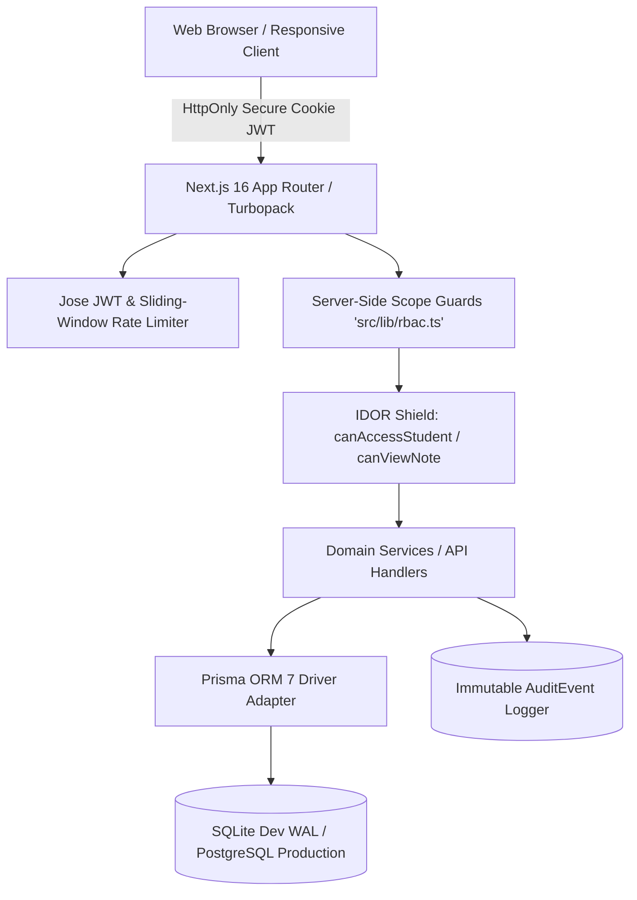

# NMAMIT Mentor–Mentee Portal
> **NMAM Institute of Technology (NMAMIT), Nitte**  
> *Constituent College of Nitte (Deemed to be University), Karkala Taluk, Udupi - 574110, Karnataka*

[](https://nextjs.org/)
[](https://react.dev/)
[](https://www.prisma.io/)
[](https://www.typescriptlang.org/)
[](https://tailwindcss.com/)
[](https://github.com/Karthikv2310/Mentor-and-Mentiee)
[](https://github.com/Karthikv2310/Mentor-and-Mentiee)

---

## 📌 Executive Summary

The **NMAMIT Mentor–Mentee Portal** is an institutional-grade, full-stack mentoring and proctor management platform specifically architected for **NMAM Institute of Technology, Nitte**. It replaces decentralized paper proctor registers and ad-hoc spreadsheets with a secure, role-governed digital workspace adhering to institutional accreditation criteria (NBA & NAAC Criterion 2.2).

### Verified Institutional Dual-Mentoring Architecture
Based on official institutional policy at [NMAMIT Student Mentoring Guidance](https://nitte.edu.in/nmamit/student-mentoring.php):
1. **Class Proctor System**: Assigned per class section (e.g., Section 4-CSE-A) to monitor attendance (>75% statutory threshold), mid-semester examination (MSE-1) marks, and semester eligibility.
2. **Faculty Advisor System**: Assigned on an individual basis to students with qualifying admission criteria (e.g., PCM < 65% in 12th/PUC), lateral entry candidates, or students flagged as slow learners post-MSE-1 for personalized remedial tutoring.

---

## 📑 Table of Contents

- [Key Capabilities](#-key-capabilities)
- [System Architecture](#-system-architecture)
- [Role-Based Access Control (RBAC) Matrix](#-role-based-access-control-rbac-matrix)
- [Database Schema (18 Relational Models)](#-database-schema-18-relational-models)
- [REST API Endpoints](#-rest-api-endpoints)
- [Pre-Seeded Demonstration Accounts](#-pre-seeded-demonstration-accounts)
- [Automated Test Suite (15/15 Passed)](#-automated-test-suite-1515-passed)
- [Quickstart & Local Installation](#-quickstart--local-installation)
- [Production Deployment & Disaster Recovery](#-production-deployment--disaster-recovery)
- [Project Documentation Deliverables](#-project-documentation-deliverables)
- [Institutional Disclaimer](#-institutional-disclaimer)

---

## 🚀 Key Capabilities

- **Strict Server-Side Scoping (IDOR Proof)**: Mentors can only view and update their explicitly assigned students. Department HoDs can only access students within their assigned branch. Attempts to access unauthorized records via URL manipulation return `403 Forbidden`.
- **Three-Tier Confidential Notes**:
  - `STUDENT_VISIBLE`: Shared goals, feedback, and academic action plans visible to the student.
  - `MENTOR_ONLY`: Private mentor observations shielded from the mentee and general teachers.
  - `RESTRICTED_COUNSELLING`: High-sensitivity psychiatric or disciplinary notes shielded from general faculty, HoDs, and students.
- **Conflict-Free Meeting Scheduling**: Timezone-aware booking normalized in `Asia/Kolkata` (IST, UTC+05:30) with automatic collision detection.
- **Academic Progression Trajectory**: Student identity (USN) is decoupled from semester progression tuples (`StudentProgression`), ensuring historical SGPA, CGPA, and MSE marks are preserved when advancing semesters.
- **Bulk CSV Student Ingestion**: Streamed file upload with pre-commit validation preview, duplicate detection, and row-level error reporting with downloadable failure reports.
- **Staged Faculty Review**: Scraped official NMAMIT faculty profiles are staged in an administrative review queue; public listing is decoupled from active authentication access.
- **Forensic Audit Logging**: Immutable audit trail capturing actor ID, action type, IP address, and before/after diff payloads for institutional compliance.

---

## 🏛️ System Architecture



---

## 🔐 Role-Based Access Control (RBAC) Matrix

Access control is strictly enforced on the server within `src/lib/rbac.ts`:

| Functional Capability | Institution Admin | Department HoD | Teacher / Mentor | Student / Mentee |
| :--- | :---: | :---: | :---: | :---: |
| **System Settings & Policy Limits** | ✅ Full Control | ❌ Denied | ❌ Denied | ❌ Denied |
| **Faculty Staging & Approval** | ✅ Full Control | 👁️ View Department | ❌ Denied | ❌ Denied |
| **Student Creation (Single & CSV)** | ✅ Global Scope | ✅ Assigned Dept | ✅ Assigned Dept | ❌ Denied |
| **Mentor Allocation & Reassign** | ✅ Global Scope | ✅ Assigned Dept | ❌ Denied | ❌ Denied |
| **View Student Profile Dossier** | ✅ All Students | ✅ Assigned Dept | 👥 Assigned Mentees | 👤 Own Profile Only |
| **Schedule Mentoring Sessions** | ✅ Global Scope | ✅ Assigned Dept | 👥 Assigned Mentees | 📅 Request Booking |
| **Student-Visible Notes** | ✅ Visible | ✅ Visible | ✅ Visible | ✅ Visible (Own) |
| **Mentor-Only Private Notes** | ✅ Visible | ✅ Assigned Dept | 👥 Author Mentor | 🛡️ **Shielded** |
| **Restricted Counseling Notes** | 🔒 Special Role | 🛡️ **Shielded** | 👥 Author Mentor | 🛡️ **Shielded** |
| **Forensic Audit Log Trail** | ✅ Full Access | ❌ Denied | ❌ Denied | ❌ Denied |

---

## 🗄️ Database Schema (18 Relational Models)

Configured with **Prisma 7** in `prisma/schema.prisma` with `@prisma/adapter-better-sqlite3`:

```
User (Authentication & JWT identity)
├── Department (Verified NMAMIT Branches: CSE, ISE, ECE, EEE, MECH, CIVIL, etc.)
│   ├── BatchSection (e.g., CSE-2023-A, ISE-2023-B)
│   ├── FacultyProfile (Staged & verified academic staff records)
│   └── StudentProfile (Core identity keyed by USN, e.g., 4NM23CS042)
│       ├── StudentProgression (Semester-by-semester historical SGPA, MSE marks, attendance)
│       ├── MentorAssignment (Active & historical links with PROCTOR vs ADVISOR roles)
│       ├── ActionItem (Remedial goals, deadlines, and completion status)
│       └── AppointmentRequest (Mentee-initiated booking requests)
├── Meeting (Conflict-checked sessions in Asia/Kolkata)
│   ├── MeetingParticipant (Attendance tracking: PRESENT, ABSENT, EXCUSED)
│   └── MeetingNote (Tiered visibility: STUDENT_VISIBLE, MENTOR_ONLY, RESTRICTED_COUNSELLING)
├── ImportJob & ImportRowError (Bulk CSV ingestion tracking with row-level error reporting)
├── AuditEvent (Immutable forensic audit log)
├── SourceVerificationRecord (Official citation URLs and verification timestamps)
└── InstitutionalSetting (Configurable limits: max mentee capacity, MSE remedial triggers)
```

---

## 🔌 REST API Endpoints

All protected endpoints require a valid `nmamit_session` cookie issued via Jose JWT:

| Method & Route | Authorized Scopes | Description |
| :--- | :--- | :--- |
| `POST /api/auth/login` | Public | Rate-limited authentication; returns HttpOnly JWT session |
| `POST /api/auth/logout` | Signed-In | Clears authentication cookie |
| `GET /api/auth/me` | Signed-In | Current authenticated user context and role scope |
| `GET /api/students` | Admin, HoD, Mentor | Scoped student directory with search, filter, and pagination |
| `POST /api/students` | Admin, HoD, Mentor | Single student creation within permitted department scope |
| `POST /api/students/import` | Admin, HoD, Mentor | Bulk CSV import with validation dry-run and atomic commit |
| `GET /api/students/[id]` | Scoped / Self | Detailed student profile dossier, semester progression, notes |
| `POST /api/mentors/assign` | Admin, HoD | Allocate or transfer mentors with capacity limit checks (max 25) |
| `GET /api/meetings` | Signed-In | Scoped meeting session list and calendar slots |
| `POST /api/meetings` | Admin, HoD, Mentor | Create one-to-one or group session with conflict validation |
| `POST /api/meetings/[id]` | Assigned Organizer | Record mentee attendance and formulate locked tiered notes |
| `GET /api/reports` | Admin, HoD | Scoped operational reports (Unassigned, Workloads, Attendance) |
| `GET /api/faculty/staging` | Admin, HoD | Public faculty directory review queue |
| `POST /api/faculty/staging` | Admin Only | Approve staged faculty and provision login accounts |
| `GET /api/audit-logs` | Admin Only | Searchable forensic security audit log |

---

## 👥 Pre-Seeded Demonstration Accounts

For demonstration and security evaluation, pre-seeded accounts are initialized with password: `NMAMIT@Demo2026!`

| Role Persona | Email Identifier | Assigned Scope & Responsibilities |
| :--- | :--- | :--- |
| **Institution Administrator** | `admin@nmamit.nitte.edu.in` | Global (All departments, staging approvals, audit logs, policies) |
| **Department HoD (CSE)** | `hod.cse@nmamit.nitte.edu.in` | Dept of Computer Science & Engineering (Mentors allocation board) |
| **Teacher / Class Proctor** | `mentor@nmamit.nitte.edu.in` | Proctor for Section 4-CSE-A (Attendance, meeting records, notes) |
| **Student / Mentee** | `student@nmamit.nitte.edu.in` | USN `4NM23CS042` (4th Sem CSE, view proctor, action plans) |

> 💡 **Demo Role Switcher**: A sticky banner at the top of the application allows instant 1-click persona switching during evaluation without manually logging in and out.

---

## ✅ Automated Test Suite (15/15 Passed)

Run via `npx tsx tests/security_and_acceptance.test.ts`:

```
=======================================================
🧪 NMAMIT PORTAL: AUTOMATED ACCEPTANCE & SECURITY TESTS
=======================================================

✅ PASS: Test 1: Teacher creates authorized student (within authorized CSE department)
✅ PASS: Test 2: Scope enforcement (Teacher blocked from adding to unauthorized ISE department)
✅ PASS: Test 3: Duplicate institutional identifiers rejected (USN '4NM23CS042')
✅ PASS: Test 4: Row-level import validation errors reported with exact row numbers
✅ PASS: Test 5: Bulk import idempotency & deduplication on retry
✅ PASS: Test 6: Student data isolation (Student authorized for own record; blocked from others)
✅ PASS: Test 7: IDOR Guard (Teacher blocked from accessing unassigned student profile)
✅ PASS: Test 8: Department Coordinator scoped isolation (CSE HoD denied ISE records)
✅ PASS: Test 9: Tiered note privacy (Private & restricted notes shielded from student responses)
✅ PASS: Test 10: Reassignment preserves history with TRANSFERRED status and logged reason
✅ PASS: Test 11: Deactivated user session guard (User with isActive: false rejected)
✅ PASS: Test 12: Timezone conflict detection in Asia/Kolkata
✅ PASS: Test 13: Export scope strictly matches on-screen RBAC boundaries
✅ PASS: Test 14: Semester progression preserves historical trajectory (Sem 4 SGPA 8.42 + Sem 5)
✅ PASS: Test 15: Cryptographic password storage verification (Salted bcrypt hashes, zero plaintext)

=======================================================
📊 TEST EXECUTION SUMMARY: 15 / 15 TESTS PASSED
=======================================================
```

---

## ⚡ Quickstart & Local Installation

### Prerequisites
- Node.js `18.x`, `20.x`, or `25.x`
- npm `9.x` or `11.x`

### Step-by-Step Setup

```bash
# 1. Clone repository
git clone https://github.com/Karthikv2310/Mentor-and-Mentiee.git
cd Mentor-and-Mentiee

# 2. Install dependencies
npm install

# 3. Configure environment variables
cp .env.example .env

# 4. Synchronize database schema
npx prisma db push

# 5. Seed institutional data and demonstration users
npx tsx prisma/seed.ts

# 6. Execute automated acceptance & security tests
npx tsx tests/security_and_acceptance.test.ts

# 7. Start the local development server
npm run dev
```

Visit [http://localhost:3000](http://localhost:3000) to access the portal.

---

## 🚀 Production Deployment & Disaster Recovery

### Production Build
```bash
# Validates TypeScript, Turbopack bundling, and route prerendering
npm run build
npm run start
```

### PostgreSQL Migration Path
For enterprise production environments:
1. Update `prisma/schema.prisma`:
   ```prisma
   datasource db {
     provider = "postgresql"
     url      = env("DATABASE_URL")
   }
   ```
2. Set your production PostgreSQL connection string in `.env`.
3. Apply migrations: `npx prisma migrate deploy`.

### Disaster Recovery & Backups
- **SQLite Hot Backup**: Database operates in WAL mode. Execute hot snapshots via:
  ```powershell
  sqlite3 dev.db ".backup 'backups/nmamit_portal_$(Get-Date -Format 'yyyyMMdd_HHmmss').db'"
  ```
- **PostgreSQL Hot Backup**: Configure standard daily `pg_dump` snapshots with 30-day retention.

---

## 📖 Project Documentation Deliverables

The repository includes the complete institutional documentation package:
- **Formal Project Report (Word Document)**: [`NMAMIT_Mentor_Mentee_Portal_Project_Report.docx`](./NMAMIT_Mentor_Mentee_Portal_Project_Report.docx)
- **Formal Project Report (Markdown)**: [`NMAMIT_Mentor_Mentee_Portal_Project_Report.md`](./NMAMIT_Mentor_Mentee_Portal_Project_Report.md)
- **Automated Test Suite**: [`tests/security_and_acceptance.test.ts`](./tests/security_and_acceptance.test.ts)

---

## ⚖️ Institutional Disclaimer

This software is an institutional engineering prototype developed for **NMAM Institute of Technology, Nitte**. It is not officially endorsed or deployed as the production campus software of Nitte (Deemed to be University) unless certified by written institutional authorization. All demonstration student records are synthetic and strictly decoupled from verified public faculty information.
